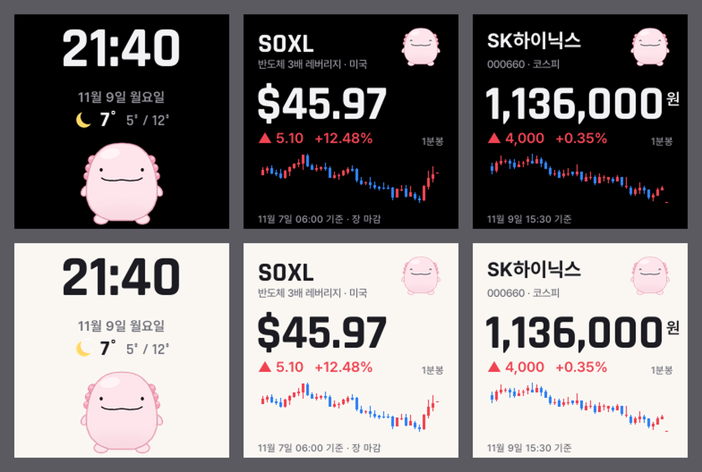

# pet

GeekMagic SmallTV-Ultra(ESP8266 · 240×240 화면)에 올리는 커스텀 펌웨어다. 테마 3개를 라이트 · 다크로 보여 준다.



## 테마

| 테마 | 내용 | 데이터 |
| --- | --- | --- |
| 우파루파 | 시계 · 날짜 · 서울 날씨 · 숨쉬고 눈을 깜빡이는 우파루파 | Open-Meteo (15분마다) |
| SOXL | 가격 · 등락 · 1분봉 캔들 40개 (프리마켓 · 애프터마켓 포함) | Yahoo Finance (거래 중 1분마다) |
| SK하이닉스 | 가격 · 등락 · 1분봉 캔들 40개 (넥스트레이드 프리 · 애프터 포함) | 네이버 증권 (거래 중 1분마다) |

- 캔들은 오르면 빨강, 내리면 파랑이다 (국내 증권 앱 관례)
- 주가 테마 오른쪽 위의 작은 우파루파는 오르면 웃고 내리면 시무룩하다
- 화면 모드: 자동(아침 7시 ~ 저녁 7시 라이트) · 라이트 · 다크

## 설정 페이지

기기가 와이파이에 붙으면 켜질 때 화면에 주소가 잠깐 뜬다. 같은 와이파이의 폰 · PC 에서 `http://<주소>/` 를 연다.

- 테마 고르기 · 화면 모드 · 와이파이 바꾸기 · 펌웨어 올리기(`/update`)
- 와이파이에 못 붙으면 기기가 `pet-setup` 와이파이를 띄운다. 폰을 붙이고 `http://192.168.4.1/` 에서 와이파이를 고른다 (2.4GHz 만, 이름은 대소문자까지 같아야 한다)

## 빌드

```sh
python tools/assets.py   # 그림 · 글자 데이터 → src/assets.h (tools/themes.py 가 모양을 정한다)
pio run                  # → .pio/build/ultra/firmware.bin
```

- 화면 미리보기: `python tools/themes.py` → `tools/themes_v2.png`
- 플래시 배치는 `eagle.flash.4m2m.ld`(코드 1MB · 파일 시스템 2MB) 라 펌웨어가 1MB 가까이 커져도 와이파이로 올릴 수 있다

## 처음 올리기 (순정 펌웨어에서)

1. 순정 펌웨어의 업데이트 페이지 `http://<주소>/update` 에 `firmware.bin` 을 올린다
2. 순정 펌웨어는 남은 공간보다 큰 파일을 거절한다. 거절되면 [브리지 펌웨어](https://github.com/wonjj6768/smalltv-ultra-korean-custom-firmware/releases)를 먼저 올리고 `http://192.168.4.1/bridgeupdate` 에서 이 펌웨어를 올린다
3. 그 뒤로는 이 펌웨어의 `/update` 로 올린다

## 안전 장치

- 켜지고 30초 동안은 주가 · 날씨를 받지 않는다 (그 사이에 업데이트를 올릴 수 있다)
- 두 번 연속 멈춰 다시 켜지면 안전 모드로 켜진다 - 화면을 그리지도 받지도 않고 주소만 띄운 채 업데이트를 기다린다
- 설정 페이지에 마지막 재시작 이유와 멈춘 위치(`epc1`)가 보인다. `xtensa-lx106-elf-addr2line -e .pio/build/ultra/firmware.elf <epc1>` 로 코드 위치를 찾는다
- 플래시(PROGMEM)는 4바이트 단위로만 읽는다. `pgm_read_word` 처럼 2바이트로 바로 읽으면 칩이 멈춘다 (`flashWord` · `memcpy_P` 를 쓴다)

## 출처 · 라이선스

- 화면 핀 · 초기화 값: [wonjj6768/smalltv-ultra-korean-custom-firmware](https://github.com/wonjj6768/smalltv-ultra-korean-custom-firmware) (GPL-3.0) 의 브리지 펌웨어에서 확인했다
- 글꼴: [Rajdhani](https://github.com/google/fonts/tree/main/ofl/rajdhani) · [Pretendard](https://github.com/orioncactus/pretendard) - 둘 다 SIL Open Font License 1.1, `tools/fonts` 에 라이선스를 함께 둔다
- 주가: Yahoo Finance · 네이버 증권의 공개 화면용 주소를 쓴다 (공식 API 가 아니어서 바뀌면 멈출 수 있다). 날씨: [Open-Meteo](https://open-meteo.com/)
- 우파루파 그림은 `tools/themes.py` 가 도형으로 그린다
