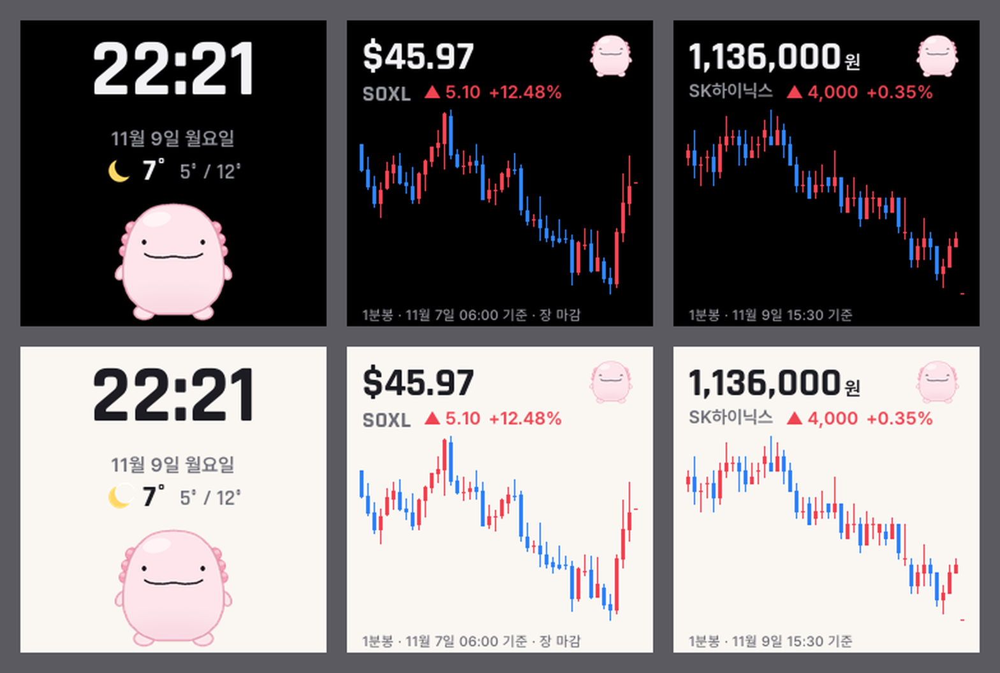

# pet

GeekMagic SmallTV-Ultra(ESP8266 · 240×240 화면)에 올리는 커스텀 펌웨어다. 테마 3개를 라이트 · 다크로 보여 준다.



## 테마

| 테마 | 내용 | 데이터 |
| --- | --- | --- |
| 우파루파 | 시계 · 날짜 · 서울 날씨 · 숨쉬고 눈을 깜빡이는 우파루파 | Open-Meteo (15분마다) |
| SOXL | 가격 · 등락 · 1분봉 캔들 30개 · 볼린저밴드 · 거래량 (데이 · 프리 · 정규 · 애프터) | 토스증권 Open API |
| SK하이닉스 | 가격 · 등락 · 1분봉 캔들 30개 · 볼린저밴드 · 거래량 (넥스트레이드 프리 · 애프터 포함) | 토스증권 Open API |

- 캔들은 오르면 빨강, 내리면 파랑이다 (국내 증권 앱 관례). 거래량은 차트 아래 띠에 같은 색으로 연하게 그린다
- 볼린저밴드는 종가 20개 평균 ± 2 표준편차다. 맨 왼쪽 캔들까지 그리려고 1분봉을 49개 받아 두고, 화면에는 끝에서 30개만 그린다
- 등락 기준가는 이미 끝난 정규장 가운데 가장 최근 날의 종가다 (데이 · 프리 · 정규 중에는 전 영업일, 애프터에는 그날)
- 국내 기준가는 아직 틀린다: 토스 국내 일봉은 넥스트레이드 애프터(20:00)까지 합친 종가라 KRX 종가와 다르다. 15:30 종가 단일가 1분봉으로 바꿀 것
- 주가 테마 오른쪽 위의 작은 우파루파는 오르면 웃고 내리면 시무룩하다
- 화면 모드: 자동(아침 7시 ~ 저녁 7시 라이트) · 라이트 · 다크
- 주가 화면 맨 아래 시각은 마지막 체결 시각(초까지)이다

## 토스증권 실시간

- 설정 페이지 맨 아래에 토스증권 Open API 의 `client_id` · `client_secret` 을 넣는다. 키는 기기(EEPROM)에만 저장하고 페이지에 다시 보이지 않는다
- 토스증권 설정 > Open API > 허용 IP 에 집 공인 IP 를 등록해야 한다 (없으면 403)
- 키가 없거나 토스에 못 붙으면 주가 테마는 "못 받았어요"로 멈춘다 (다른 시세 출처는 쓰지 않는다)
- 주가 테마를 켜면 HTTPS 로 1분봉 49개(`/api/v1/candles`) · 장 운영 캘린더(`/api/v1/market-calendar/{US|KR}`) · 기준가용 일봉을 받고, `wss://openapi-ws.tossinvest.com/ws/v1` 에 붙어 체결이 올 때마다 가격 · 마지막 캔들 · 거래량을 갱신한다 (화면은 초당 4번까지)
- 세션 표시(데이마켓 · 프리마켓 · 애프터마켓 · 장 마감)는 장 운영 캘린더를 따른다. 휴장일도 캘린더가 알려 준다
- 시세를 못 받으면 전 차트를 그대로 두고, 소켓을 붙이기 전에 45초 뒤 다시 받는다. 3번 연속 못 받으면 전 차트로 실시간만 잇는다
- 토큰은 키당 하나만 유효하다 - 같은 키를 쓰는 다른 프로그램이 있으면 서로 끊긴다
- 메모리: 소켓 받기 버퍼 6KB(토스 인증서 묶음 3.7KB). 연결 중 남는 메모리는 약 5KB 라, 소켓이 붙어 있는 동안에는 다른 HTTPS 를 받지 않는다. 30분마다 소켓을 닫고 시세를 새로 받는다. 1분봉은 응답을 한 칸씩 읽고, 캔들 칸은 두 종목이 같이 쓴다
- 확인용: `http://<주소>/toss/raw?p=<경로>` 로 토스 시세 원본을 본다. 시세 · 체결 · 캔들 · 장 캘린더 경로만 열고 계좌 · 주문 경로는 막는다 (경로의 `?` · `&` · `+` 는 URL 인코딩)

## 설정 페이지

기기가 와이파이에 붙으면 켜질 때 화면에 주소가 잠깐 뜬다. 같은 와이파이의 폰 · PC 에서 `http://<주소>/` 를 연다.

- 테마 고르기 · 화면 모드 · 와이파이 바꾸기 · 펌웨어 올리기(`/update`)
- 와이파이에 못 붙으면 기기가 `pet-setup` 와이파이를 띄운다. 폰을 붙이고 `http://192.168.4.1/` 에서 와이파이를 고른다 (2.4GHz 만, 이름은 대소문자까지 같아야 한다)

## 빌드

```sh
python tools/assets.py   # 그림 · 글자 데이터 → src/assets.h (tools/themes.py 가 모양을 정한다)
pio run                  # → .pio/build/ultra/firmware.bin
```

- 화면 미리보기: `python tools/themes.py` → `tools/themes_v3.png`
- 플래시 배치는 `eagle.flash.4m2m.ld`(코드 1MB · 파일 시스템 2MB) 라 펌웨어가 1MB 가까이 커져도 와이파이로 올릴 수 있다

## 처음 올리기 (순정 펌웨어에서)

1. 순정 펌웨어의 업데이트 페이지 `http://<주소>/update` 에 `firmware.bin` 을 올린다
2. 순정 펌웨어는 남은 공간보다 큰 파일을 거절한다. 거절되면 [브리지 펌웨어](https://github.com/wonjj6768/smalltv-ultra-korean-custom-firmware/releases)를 먼저 올리고 `http://192.168.4.1/bridgeupdate` 에서 이 펌웨어를 올린다
3. 그 뒤로는 이 펌웨어의 `/update` 로 올린다

## 안전 장치

- 켜지고 30초 동안은 주가 · 날씨를 받지 않는다 (그 사이에 업데이트를 올릴 수 있다)
- 두 번 연속 멈춰 다시 켜지면 안전 모드로 켜진다 - 화면을 그리지도 받지도 않고 주소만 띄운 채 업데이트를 기다린다
- 설정 페이지에 마지막 재시작 이유와 멈춘 위치(`epc1`)가 보인다. `xtensa-lx106-elf-addr2line -e .pio/build/ultra/firmware.elf <epc1>` 로 코드 위치를 찾는다
- 펌웨어를 받기 시작하면 토스 소켓부터 닫는다 (소켓이 붙은 채로 받으면 메모리가 모자라 멈춘다)
- 플래시(PROGMEM)는 4바이트 단위로만 읽는다. `pgm_read_word` 처럼 2바이트로 바로 읽으면 칩이 멈춘다 (`flashWord` · `memcpy_P` 를 쓴다)

## 출처 · 라이선스

- 화면 핀 · 초기화 값: [wonjj6768/smalltv-ultra-korean-custom-firmware](https://github.com/wonjj6768/smalltv-ultra-korean-custom-firmware) (GPL-3.0) 의 브리지 펌웨어에서 확인했다
- 글꼴: [Rajdhani](https://github.com/google/fonts/tree/main/ofl/rajdhani) · [Pretendard](https://github.com/orioncactus/pretendard) - 둘 다 SIL Open Font License 1.1, `tools/fonts` 에 라이선스를 함께 둔다
- 주가: [토스증권 Open API](https://developers.tossinvest.com/) (명세 `openapi.tossinvest.com/openapi-docs/latest/openapi.json` · `asyncapi.json`). 날씨: [Open-Meteo](https://open-meteo.com/)
- 우파루파 그림은 `tools/themes.py` 가 도형으로 그린다
